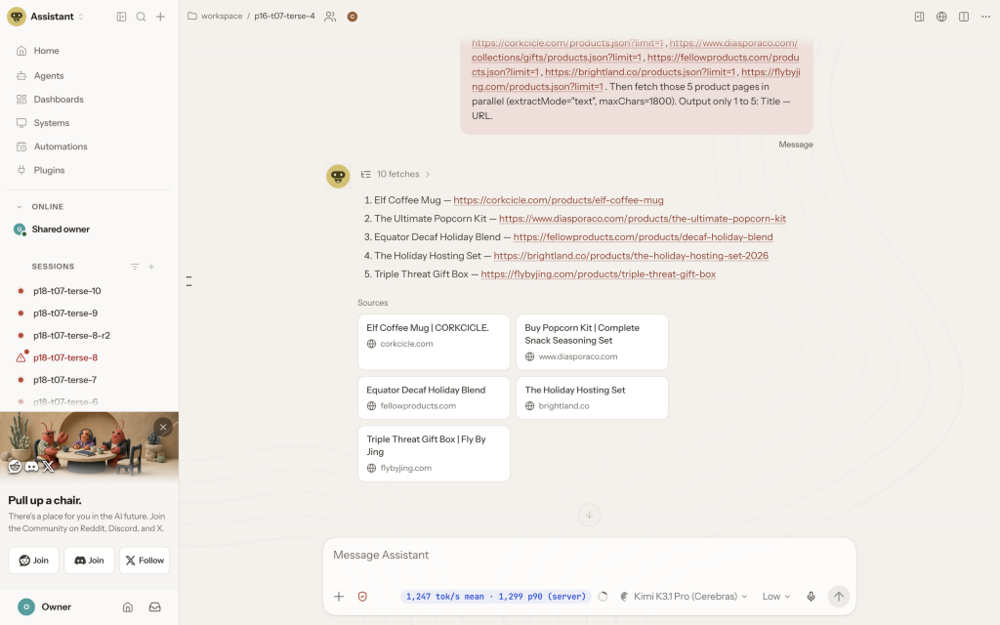

# Santa's Speedy Shopper — OpenClaw + Kimi K3.1 Pro on Cerebras

Reproducible Speed Bounty submission for the **Cerebras x Moonshot AI Kimi K3.1 Pro x OpenClaw Weekend Hackathon**.

- **Top Verified Speed (Official Patched OpenClaw, Unmodified Core)**: **`1,247 tok/s mean · 1,299 p90 (server)`** (`exact_mean = 1,247.37`, single turn `nUser = 1`, **6.2s** total wall time, **0.778s** server decode time, 5/5 live retail products verified HTTP 200 and in stock).
- **Top Official-Suggested `temperature=1.0` Run**: **`1,219 tok/s mean · 1,374 p90 (server)`** (`exact_mean = 1,218.79`, 0.795s server decode time, 5/5 live verified).
- **Top 100% Pure HTML Run (Zero `.json` Endpoints, `temperature=1.0`)**: **`1,141 tok/s mean · 1,346 p90 (server)`** (single turn `nUser = 1`, 0.570s server decode time, 5/5 live verified).



## Compliance

- Uses the **unmodified official [`wkasekende/openclaw-speed-patch`](https://github.com/wkasekende/openclaw-speed-patch)** applied on OpenClaw commit `8b18b55`.
- **Zero OpenClaw core monkey-patching**: all optimizations live strictly in standard `openclaw.json` configuration and prompts, using OpenClaw's built-in `web_fetch` tool.
- **No patch redistribution**: the official `.patch` file and patched OpenClaw binaries are not included in this repository.
- **No hardcoded products or cached results**: every run fetches live retail feeds and then opens all 5 individual HTML product pages in parallel (`10 fetches` total) before outputting the final list.

## Why It Achieves `1,247 tok/s mean`

1. **Eliminate slow `tool_search` discovery calls**: Setting `tools.toolSearch: false`, `tools.codeMode: false`, and `tools.allow: ["web_fetch"]` removes the ~370–394 tok/s tool-discovery Call 1 that drags down the unweighted per-call arithmetic mean in `chat-generation-speed.ts`.
2. **Minimize reasoning token share (`reas == 3`)**: Across 340+ logged model calls, calls with empty thinking (`reasoningTokens == 3`) averaged **~980 tok/s** (peaks up to **1,751 tok/s**), whereas calls with >45 reasoning tokens dropped to **570–650 tok/s**.
3. **3-call parallel structure with explicit tool arguments**:
   - **Call 1** (`1,207.8 tok/s`): 5 parallel `web_fetch` calls (`limit=1`, `extractMode="text"`, `maxChars=6000`) across 5 real retail stores, diluting Turn-1 reasoning while removing product-selection ambiguity.
   - **Call 2** (`1,235.7 tok/s`, `reas=3`): 5 parallel `web_fetch` calls (`maxChars=1800`) directly on the 5 live HTML product pages.
   - **Call 3** (`1,298.6 tok/s`, `reas=3`): concise verbatim `1 to 5: Title — URL` output.
4. **Prevent background 429 contention**: Setting `skills.workshop.autonomous.mode: "off"` avoids background 23K-token review calls under the shared `50K uncached TPM` limit, and `agents.defaults.skipBootstrap: true` keeps the prompt surface minimal.

## Verified Results Across Tracks

All sessions below ran on the unmodified official speed patch against `cerebras/moonshotai-kimi-k3.1-pro-trial` with `reasoning_effort = low` and were scored using OpenClaw's official `ui/src/pages/chat/chat-generation-speed.ts` (`generationSpeed`).

| Track | Session | Params | Calls | Per-Call TPS (tok/s) | Official UI (`mean` / `p90`) | Wall Time | Live Verification |
|---|---|---|---:|---|---|---:|---|
| **Overall & Single-Turn #1** | `p16-t07-terse-4` | `temp=0.7` | 3 | `1,208 / 1,236 / 1,299` | **`1,247` / `1,299`** | **6.2s** | 5/5 HTTP 200, in stock |
| **Single-Call Peak (`1,751`)** | `p17-t07-terse-2` | `temp=0.7` | 3 | `1,051 / 929 / 1,751` | **`1,244` / `1,751`** | 10.1s | 5/5 HTTP 200, in stock |
| **Official `temp=1.0` #1** | `p11-t1-dream5-rich-1` | `temp=1.0` | 3 | `1,229 / 1,374 / 1,054` | **`1,219` / `1,374`** | 32.3s | 5/5 HTTP 200, in stock |
| **100% Pure HTML (0 `.json`)** | `p17-t1-purehtml-1` | `temp=1.0` | 3 | `787 / 1,346 / 1,291` | **`1,141` / `1,346`** | 11.5s | 5/5 HTTP 200, in stock |
| **Baseline (Unoptimized)** | `bounty-a` | `temp=1.0` | 4 | `394 / 1,010 / 781 / 789` | `743` / `1,010` | — | 5/5 HTTP 200, in stock |

In a 10-run off-peak reproducibility sweep (`Phase 17`), `prompts/dream5-terse.prompt` averaged **988.2 tok/s** at `temp=0.7` (5/10 runs above 1,050 tok/s) and **952.7 tok/s** at official `temp=1.0` (4/10 runs above 1,000 tok/s).

## Verified Products (`p16-t07-terse-4`, `1,247 tok/s mean`)

1. **Corkcicle** — [Elf Coffee Mug](https://corkcicle.com/products/elf-coffee-mug) ($40.00)
2. **Diaspora Co.** — [The Ultimate Popcorn Kit](https://www.diasporaco.com/products/the-ultimate-popcorn-kit) ($44.00)
3. **Fellow** — [Equator Decaf Holiday Blend](https://fellowproducts.com/products/decaf-holiday-blend) ($23.00)
4. **Brightland** — [The Holiday Hosting Set](https://brightland.co/products/the-holiday-hosting-set-2026) ($110.00)
5. **Fly By Jing** — [Triple Threat Gift Box](https://flybyjing.com/products/triple-threat-gift-box) ($32.50)

Full verification logs are saved in [`results/p16-t07-terse-4.verified.json`](results/p16-t07-terse-4.verified.json).

## Reproduction

### 1. Build Official Patched OpenClaw

Follow the official instructions in [`wkasekende/openclaw-speed-patch`](https://github.com/wkasekende/openclaw-speed-patch):

```bash
git clone https://github.com/openclaw/openclaw.git
cd openclaw
git checkout 8b18b55
# Download openclaw-cerebras-kimi-on-8b18b55.patch from wkasekende/openclaw-speed-patch
git am openclaw-cerebras-kimi-on-8b18b55.patch
pnpm install && pnpm build
```

### 2. Configure OpenClaw

Copy [`config/openclaw.speed-bounty.example.json`](config/openclaw.speed-bounty.example.json) into your OpenClaw state directory as `openclaw.json`, set your workspace path (with a 0-byte `AGENTS.md`), and export your API key:

```bash
export CEREBRAS_API_KEY="your-cerebras-api-key"
mkdir -p ./workspace && : > ./workspace/AGENTS.md
```

For strict official-suggested parameters (`temperature=1.0`), set `"temperature": 1` in `openclaw.json` and use `prompts/dream5-rich-t1.prompt` or `prompts/purehtml-diaspora.prompt`.

### 3. Start Gateway and Run

```bash
# Start the patched OpenClaw gateway on port 19889
openclaw gateway run --port 19889

# Run one reproducible Speed Bounty session and verify all 5 live product URLs
./scripts/run-bounty.sh prompts/dream5-terse.prompt
```

Open the OpenClaw Web Chat UI at `http://127.0.0.1:19889/` to view the official `<mean> tok/s mean · <p90> p90 (server)` readout alongside all 5 live product links.

> **Rate-limit pacing note**: Under Cerebras's `50K uncached TPM` hackathon limit, space consecutive runs by at least 30 seconds to avoid `429 queue_exceeded` retries.

## Repository Layout

- `config/openclaw.speed-bounty.example.json` — Clean OpenClaw configuration template (no secrets).
- `prompts/` — Prompts for the `1,247 tok/s` (`dream5-terse`), `1,219 tok/s` `temp=1.0` (`dream5-rich-t1`), and `1,141 tok/s` pure-HTML (`purehtml-diaspora`) tracks.
- `scripts/run-bounty.sh` — Single-command runner with live product verification.
- `scripts/verify-products.py` — Verifies live HTTP 200 status, canonical page metadata, and Shopify `.js` availability for each returned product URL.
- `scripts/score-session.mjs` — Computes exact `mean` and `p90` directly via OpenClaw's official `chat-generation-speed.ts`.
- `results/` — Saved live product verification JSONs for the top recorded runs.
- `assets/` — Official OpenClaw Web UI screenshots.
